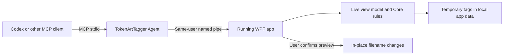

# Agent integration

TokenArtTagger exposes a local MCP stdio server backed by the running WPF app. Codex and other MCP clients can inspect images, query tags, and stage changes without computer use. A one-shot JSON command uses exactly the same tools for clients without MCP support.



The bridge has no AI model, hosted API dependency, HTTP listener, or runtime package download. `view_image` returns image content to its caller, so a cloud agent receives those pixels through its normal tool context. The separate [local benchmark client](local-ai-benchmark.md) consumes the same MCP pixels locally and calls an isolated local runtime; it does not send its inference images to a hosted service.

## Build and connect

From the repository root, build once:

```powershell
powershell.exe -NoProfile -ExecutionPolicy Bypass -File scripts/Build-Agent.ps1 -Offline
```

`-Offline` uses cached packages and the installed SDK. Omit it only if dependency downloads are intended. The bridge itself adds no NuGet dependencies. Launch the newly built `src/TokenArtTagger.App/bin/Debug/net10.0-windows/TokenArtTagger.App.exe` (or run its DLL using the project-local dotnet runtime). Keep **Agent access** enabled in the app's status area. Existing app processes need restarting to load this feature.

Register with an MCP client using the project-local runtime as the command and the bridge DLL as its argument. Use absolute paths. Example Codex configuration:

```toml
[mcp_servers.token_art_tagger]
command = 'D:\Projects\TokenArtTagger\.tools\dotnet\dotnet.exe'
args = ['D:\Projects\TokenArtTagger\src\TokenArtTagger.Agent\bin\Debug\net10.0\TokenArtTagger.Agent.dll']
startup_timeout_sec = 10
tool_timeout_sec = 150
```

Codex supports project-scoped `.codex/config.toml` and stdio servers configured with command/args. Reload the MCP connection or start a new chat if tools do not appear in an existing session. This project's generated local configuration is ignored by Git. Other MCP clients can use the same executable and arguments in their own configuration format. [Official OpenAI MCP configuration](https://developers.openai.com/codex/mcp/).

If several instances are running, call `agent_instances`, then append `--instance` and the chosen process ID to the bridge arguments. Ambiguous instances produce an error rather than choosing an arbitrary window. Use one editing app per application-data profile: separate windows do not synchronize temporary tags, and a later save can replace another window's changes. Use `TOKENARTTAGGER_DATA_DIR` for independent profiles. The bridge and app must run under the same Windows account and use the same profile. Sandbox-isolated clients may need their normal local execution permission to reach the user's app.

## Available tools

| Tool | Purpose |
|---|---|
| `agent_instances` | Discover running app instances |
| `tag_schema` | Get allowed tags and role/style dependencies |
| `app_status` | Workspace revision, counts, tag distributions, scan errors, current selection |
| `scan_images` | Populate the app from a folder, with recursion and subfolder exclusions |
| `list_images` | Bounded pages, filename/tag search, folder scope, tagged/untagged/changed/incomplete/invalid filters |
| `image_details` | Current and filename tags, revision, optional full SHA-256 |
| `view_image` | Bounded PNG image content, preserving aspect ratio; first frame only |
| `queue_ai_suggestions` | Verify source hashes/revisions and persist review-only proposals, separately from temporary tags |
| `list_ai_suggestions` | Page proposals for the current scan, with import snapshots and current image details |
| `update_tags` | Persist explicit temporary tag replacements, up to 100 images per call |
| `reset_tags` | Restore specified images to filename-derived tags |
| `select_images` | Select explicit images in the Library tab |
| `preview_rename` | Select images and populate the ordinary rename preview |

Tool schemas are discoverable through standard `tools/list`. Requests and results use JSON; normal results include both text and `structuredContent`. Image results also contain an MCP image content block. [MCP tools](https://modelcontextprotocol.io/specification/2025-11-25/server/tools).

## Saved AI proposals

`queue_ai_suggestions` accepts `suggestions` (1–100 entries). Each entry requires `id`, `expectedRevision`, source `sha256`, all four `tags`, `provider`, `model`, and `runFingerprint`. Both hashes are full lowercase SHA-256 values. Optional `evidence` is plain text, limited to 2,000 characters. Provider and model strings are limited to 80 and 256 characters. The app verifies current image bytes and revisions before the atomic import; it stores caller-reported model/run provenance without authenticating which model produced it. Null fields remain unresolved. Incompatible role/style combinations are rejected.

Proposals live in `%LOCALAPPDATA%\TokenArtTagger\AiSuggestions\queue-v1.json` (or the independent `TOKENARTTAGGER_DATA_DIR` profile). They never enter work-in-progress tags, training labels, or rename previews automatically. The queue is versioned, bounded to 5,000 records and 16 MiB, and uses a process lock plus atomic file replacement. A conflicting import rejects the entire batch. Repeating the same path/content/provider/model/run and proposal returns `alreadyPresent` and preserves the original import snapshot. Another file with identical pixels remains a separate file instance. A full queue rejects additional records; it does not silently discard history.

`list_ai_suggestions` accepts `offset`, `limit` (1–100), optional `imageId`, `expectedWorkspaceRevision`, and `expectedQueueRevision`. Save both revisions for consistent pagination. It returns suggestions only for files in the current scan, along with current image IDs/revisions, `metadataUnchanged`, and `tagsUnchanged` relative to import. Listing does **not** read the source bytes again; metadata equality is not content verification. A renamed file is not silently rebound to another file. Missing files outside the scan retain their private records but are omitted from that scan's pages.

These tools add a persistent agent proposal queue. The [desktop review window](local-ai-desktop-review.md) now supports field decisions, dismissal and immutable review receipts. While that modal window is open, MCP requests report `app_busy`. `list_ai_suggestions` still lists original proposals regardless of desktop review status; its queue revision does not track separate receipts. Archive controls and automatic inference scheduling remain future work. Review proposals through the existing image tools; use `update_tags` only for an explicitly reviewed editing action with fresh revisions. Filename labels remain authoritative. A high classifier score or an imported proposal does not authorize applying it.

The [classifier importer](local-ai-suggestions.md#save-the-pilot-to-the-agent-review-queue) joins completed private predictions to their original untagged benchmark sources, rechecks live identities, and calls the queue tool. The benchmark MCP client keeps its read-only tool allowlist.

If an active MCP bridge locks Debug build outputs, build with `scripts/Build-Agent.ps1 -Offline -Configuration Release` and use `scripts/Start-Agent.ps1 -Configuration Release -Call <tool> -ArgumentFile <private-json>`. The optional configuration also applies to `Test-AgentIntegration.ps1`. Restart the app and reload the client after selecting a newly built bridge; an already-connected bridge keeps its old tool catalog until reloaded. No connection configuration is changed automatically.

## A typical session

1. Read `app_status` and `tag_schema`.
2. Call `scan_images` with `root`, `expectedWorkspaceRevision`, and any `excludeDirectories`. Current temporary tags are saved before a new scan.
3. Page `list_images` with `state: "untagged"`, `limit: 50`, and subsequent `offset` values. Supply the returned `workspaceRevision` as `expectedWorkspaceRevision` to catch changes between pages.
4. Inspect each candidate using its `id` and `revision` with `view_image`.
5. Stage a batch using full tag replacements:

```json
{
  "changes": [
    {
      "id": "ID from list_images",
      "expectedRevision": "revision from list_images",
      "tags": {
        "gender": "female",
        "role": "range",
        "weaponOrStyle": "bow",
        "race": null
      }
    }
  ]
}
```

All four fields are required; null means unresolved. Tags must match the schema. Partial tags are allowed, but contradictory role/style pairs are rejected. The entire batch is validated before any edit. Results include the updated revisions. User edits, later agent edits, and changed file size/modification time invalidate prior revisions. IDs are valid only for the current scan; rescan to discover replacements after filenames change.

6. For complete tags, call `preview_rename` with `targets: [{"id": "...", "expectedRevision": "..."}]`. Review the returned proposed names and `canRename`. The app's **Rename Selected** button performs the final confirmation. There is no agent tool to rename, move, delete, or overwrite image files.

For folder-scoped auditing, `list_images` supports `folder` and `recursive`. A tagged subfolder nested inside an untagged root can also be excluded entirely during `scan_images`. The app honors its scan scope on rescans until a different scope is selected.

## Stable command fallback

Store the tool's JSON arguments in a file rather than constructing shell-escaped strings:

```powershell
powershell.exe -NoProfile -ExecutionPolicy Bypass -File scripts/Start-Agent.ps1 -Call app_status
powershell.exe -NoProfile -ExecutionPolicy Bypass -File scripts/Start-Agent.ps1 -Call scan_images -ArgumentFile .cache/scan-request.json
```

Without `-Call`, the script starts MCP stdio. The executable also supports `--call TOOL` directly, taking one JSON arguments object on stdin. Stdout is reserved for protocol output; diagnostics use stderr. For MCP configuration, launching the runtime/DLL directly avoids shell startup and encoding differences. [MCP stdio transport](https://modelcontextprotocol.io/specification/2025-11-25/basic/transports).

## State, limits, and recovery

- The app remains the owner of the live workspace. UI mutations are disabled during an agent request, and agents get `app_busy` during desktop scans/previews/renames. UI closing waits for temporary-tag persistence.
- Temporary-tag updates are ordered and written by atomic file replacement. Scanning a subset preserves saved tags outside that subset. A failed agent save rolls back that batch in the view model.
- Treat a connection timeout as an unknown outcome and read current state before retrying. Do not replay a stale write. Requests are serialized, with a two-minute pipe operation timeout; image batches and pagination are limited to 100.
- Named pipes use Windows `CurrentUserOnly`. Disabling **Agent access** rejects subsequent calls; it does not undo completed work. Calls show an activity label in the status area.
- Image previews are limited to a 1,536-pixel longest edge, 64 MB source file, 80 megapixel decode, and 8 MB encoded PNG. GIF/animated WebP inspection returns the first decoded frame. WebP depends on the installed Windows codecs; a decode failure is a tool error.
- Scan skips reparse-point files and subdirectories to avoid link cycles and accidentally leaving the chosen tree. It reports filesystem enumeration errors.
- Version 1 implements the tools-only MCP stdio subset for protocol versions `2025-06-18` and `2025-11-25`. It does not expose resources, prompts, subscriptions, streaming progress, or task extensions.
- The optional `TOKENARTTAGGER_DATA_DIR` environment variable redirects app state, logs, thumbnails, and discovery for independent test profiles. Both app and bridge must use the same value. Normal operation retains `%LOCALAPPDATA%\TokenArtTagger`.

## Verification

```powershell
.\.tools\dotnet\dotnet.exe test TokenArtTagger.slnx --no-restore
powershell.exe -NoProfile -ExecutionPolicy Bypass -File scripts/Test-AgentIntegration.ps1
```

The integration test launches a hidden WPF app with isolated state and generated test images, then drives all 13 tools through the actual MCP executable and named pipe. It checks stale and invalid batches, native image output, hashes, desktop selection, previews, persistence across folder changes, reset, suggestion import and unchanged original files. It closes only the processes it started. Test artifacts remain in `.cache/agent-smoke` for inspection. The separate WPF test project exercises desktop review decisions and bindings on an STA dispatcher.
